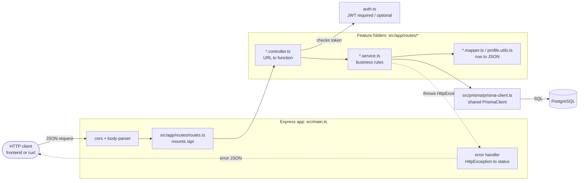
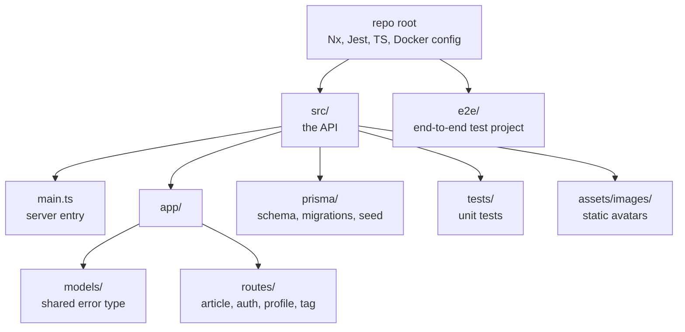
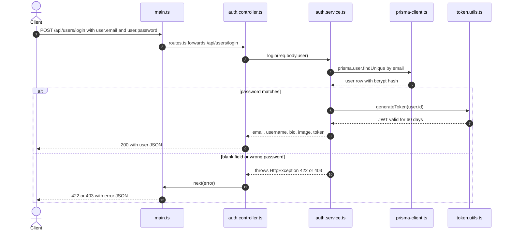
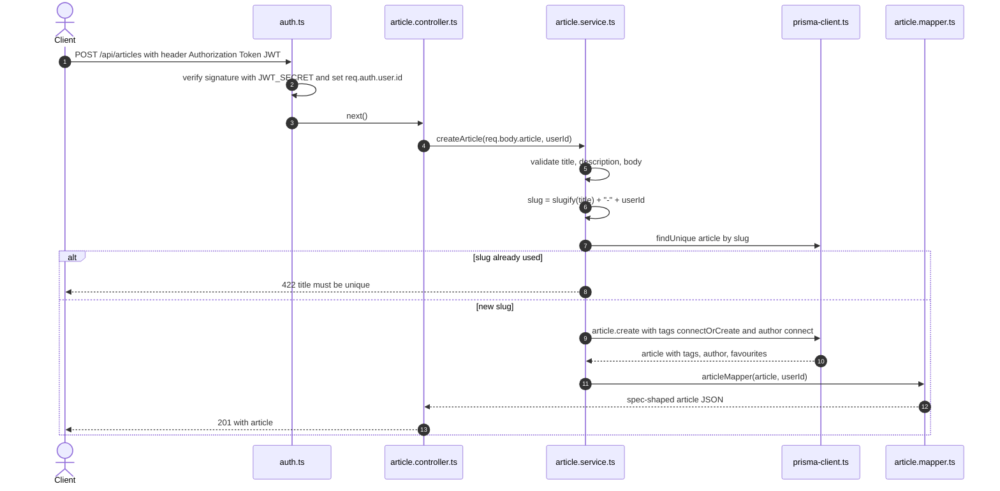
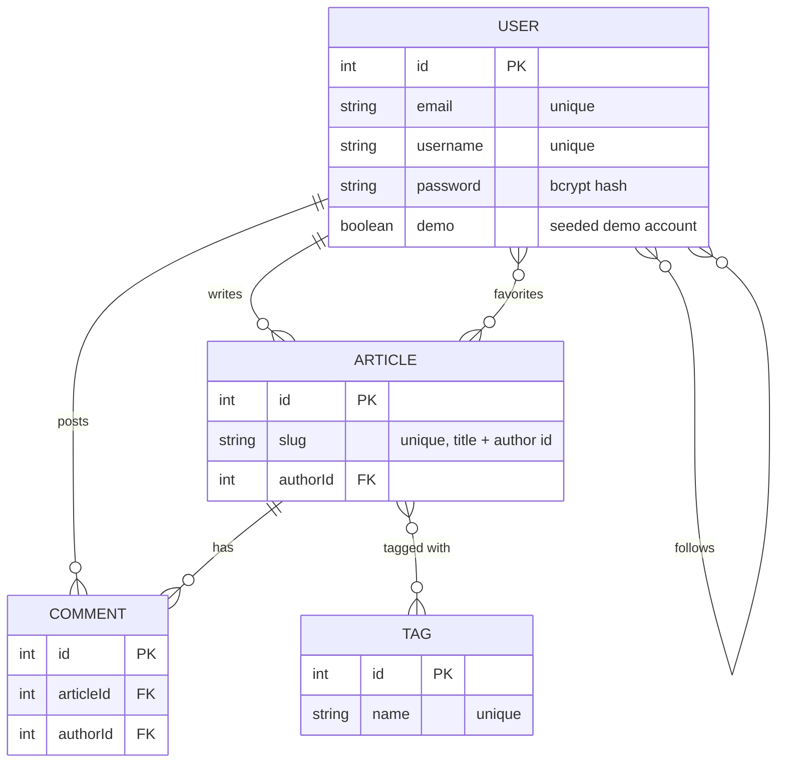

<!-- EXAMPLE OUTPUT of codebase-explainer for github.com/gothinkster/node-express-realworld-example-app. Use it only to calibrate depth and tone. -->
<!-- generated by codebase-explainer · 2026-11-13 · commit 30b68e1 -->
# node-express-realworld-example-app: Codebase Guide

> **In one sentence:** a REST API for a Medium-style blogging site ("Conduit"): users sign up, write articles, tag, favourite and comment on them, and follow each other.
>
> 57 files explained · TypeScript · Express + Prisma + PostgreSQL · commit `30b68e1`

**Contents:** [In one minute](#1-in-one-minute) · [Tech stack](#2-tech-stack) · [Run it](#3-run-it-locally) · [Architecture](#4-the-big-picture-architecture) · [Folder map](#5-folder-map) · [Main flows](#6-how-it-works-main-flows) · [Data model](#7-data-model) · [File-by-file](#8-file-by-file-guide) · [Config](#9-configuration-and-environment) · [Glossary](#10-key-concepts-and-glossary) · [Learning path](#11-learning-path-read-the-code-in-this-order) · [Common changes](#12-common-changes-where-to-start) · [Observations](#13-gotchas-and-observations)

## 1. In one minute

This is the backend half of the [RealWorld](https://github.com/gothinkster/realworld) demo spec: there is no UI, only JSON endpoints under `/api`. A request enters the Express app in `src/main.ts`, is passed to one of four **feature folders** (`article`, `auth`, `profile`, `tag`) under `src/app/routes/`, and each folder follows the same three-layer pattern: a **controller** maps the URL to a function, a **service** holds the business rules and talks to the database through **Prisma**, and a **mapper** reshapes database rows into the JSON the spec requires. Logged-in users are identified by a **JWT** sent in the `Authorization` header and checked by `src/app/routes/auth/auth.ts`. Errors thrown anywhere as `HttpException` are turned into HTTP status codes by one error handler in `src/main.ts`.

## 2. Tech stack

| Layer | Technology | What it does in this app | Where you will see it |
|---|---|---|---|
| Runtime and language | Node.js + TypeScript | Everything is TypeScript, compiled to CommonJS for Node | `tsconfig.json`, `tsconfig.app.json` |
| Web framework | Express 4 | Receives HTTP requests, routes them, sends JSON | `src/main.ts`, every `*.controller.ts` |
| Database access | Prisma 4 | Type-safe queries and migrations for PostgreSQL | `src/prisma/schema.prisma`, `src/prisma/prisma-client.ts` |
| Database | PostgreSQL | Stores users, articles, comments and tags | `src/prisma/schema.prisma` (`provider = "postgresql"`) |
| Auth | `jsonwebtoken`, `express-jwt`, `bcryptjs` | Issue tokens, verify tokens, hash passwords | `src/app/routes/auth/token.utils.ts`, `src/app/routes/auth/auth.ts`, `src/app/routes/auth/auth.service.ts` |
| Build and tasks | Nx + esbuild | `nx serve` / `nx build` / `nx test` targets | `project.json`, `nx.json` |
| Tests | Jest + `jest-mock-extended` | Unit tests for services with a mocked Prisma client | `jest.config.ts`, `src/tests/prisma-mock.ts` |
| Packaging | Docker | Runs the built `dist/api` in a small Node image | `Dockerfile` |

## 3. Run it locally

```bash
npm install
# create .env with DATABASE_URL, JWT_SECRET and NODE_ENV (names from the README)
npx prisma generate          # build the typed Prisma client from schema.prisma
npx prisma migrate deploy    # create the tables in your PostgreSQL database
npx prisma db seed           # optional: 12 demo users, each with 12 articles and comments
npx nx serve api             # dev server on http://localhost:3000, API under /api
npm test                     # unit tests (nx test)
```

You need a running PostgreSQL database reachable through `DATABASE_URL`. The seed command uses the `prisma.seed` entry in `package.json`.

## 4. The big picture (architecture)



- **Express app** (`src/main.ts`): adds CORS and JSON body parsing, mounts the router, serves images from `src/assets/`, and owns the single error handler.
- **Router** (`src/app/routes/routes.ts`): stitches the four feature routers together under the `/api` prefix.
- **JWT middleware** (`src/app/routes/auth/auth.ts`): `auth.required` rejects requests without a valid token, `auth.optional` lets them through but still reads the user id when present.
- **Feature folders**: controllers stay thin; all rules (validation, uniqueness, ownership checks) live in services.
- **Prisma client** (`src/prisma/prisma-client.ts`): the one database connection every service imports. It is the most-imported file in the repo.

## 5. Folder map



| Folder | What lives here | Why it exists |
|---|---|---|
| `src/app/routes/` | One sub-folder per API feature, plus the `routes.ts` that combines them | Keeps each feature's URL handlers, logic and types together |
| `src/app/models/` | `HttpException`, the shared error class | Lets any service fail with a status code the error handler understands |
| `src/prisma/` | Database schema, migration history, Prisma client, seed script | Single source of truth for the database |
| `src/tests/` | Jest unit tests and the Prisma mock | Tests services without a real database |
| `src/assets/images/` | Two avatar images served statically | Default and demo profile pictures |
| `e2e/` | A separate Nx test project that calls the running server | End-to-end smoke test (see [observations](#13-gotchas-and-observations)) |

## 6. How it works: main flows

### 6.1 A user signs in



1. `src/main.ts` parses the JSON body and hands the request to `src/app/routes/routes.ts`, which strips the `/api` prefix.
2. `src/app/routes/auth/auth.controller.ts` matches `POST /users/login` and calls `login()`. No token is needed for this route.
3. `src/app/routes/auth/auth.service.ts` → `login()` trims the inputs, returns 422 if either is blank, loads the user by email and compares the password with `bcrypt.compare`.
4. On success `src/app/routes/auth/token.utils.ts` → `generateToken()` signs `{ user: { id } }` with `JWT_SECRET`, valid for 60 days.
5. On failure the service throws `HttpException(403)`; the controller passes it to `next()`, and the error handler in `src/main.ts` sends the status and message.

### 6.2 A signed-in user publishes an article



1. `src/app/routes/auth/auth.ts` → `auth.required` reads the token from `Authorization: Token <jwt>` (or `Bearer`), verifies it and puts the user id on `req.auth`. A missing or bad token produces 401 via the error handler.
2. `src/app/routes/article/article.service.ts` → `createArticle()` builds the slug from the title plus the **author's** id, so two different users can publish the same title.
3. Tags use Prisma's `connectOrCreate`: existing tags are linked, new ones are created in the same query.
4. `src/app/routes/article/article.mapper.ts` turns the row into the RealWorld shape (`tagList` as strings, `favorited`, `favoritesCount`, nested `author` built by `src/app/routes/article/author.mapper.ts`).

## 7. Data model



All four models are defined in `src/prisma/schema.prisma`. The many-to-many links (tags, favourites, follows) are implicit Prisma relations, so there are no join-table models in the code; Prisma creates hidden join tables in the migrations. Deleting a user cascades to their articles and comments.

## 8. File-by-file guide

### `src/` (entry)

| File | What it does | Why the app needs it | Connects to |
|---|---|---|---|
| `src/main.ts` | Creates the Express app, adds CORS and body parsing, mounts the routes, serves `src/assets/`, converts errors to HTTP responses, listens on `PORT` (default 3000). | Without it nothing listens for requests and thrown errors would crash requests instead of returning JSON. | uses `src/app/routes/routes.ts`, `src/app/models/http-exception.model.ts` |

### `src/app/routes/`

| File | What it does | Why the app needs it | Connects to |
|---|---|---|---|
| `src/app/routes/routes.ts` | Combines the tag, article, profile and auth routers and mounts them under `/api`. | Without it none of the feature endpoints are reachable. | used by `src/main.ts`; uses every `*.controller.ts` |

### `src/app/routes/auth/`

_Sign-up, sign-in, the current user, and the JWT machinery every other feature relies on._

| File | What it does | Why the app needs it | Connects to |
|---|---|---|---|
| `src/app/routes/auth/auth.ts` | Exports `auth.required` and `auth.optional` Express middlewares that read and verify the JWT from the `Authorization` header. | Every protected route depends on it; without it the API cannot tell who is calling. | used by all four controllers |
| `src/app/routes/auth/auth.controller.ts` | Routes `POST /users`, `POST /users/login`, `GET /user`, `PUT /user`. | Without it users cannot register, log in or edit their account. | uses `src/app/routes/auth/auth.service.ts`, `src/app/routes/auth/auth.ts` |
| `src/app/routes/auth/auth.service.ts` | `createUser()` validates, checks email/username uniqueness, hashes the password and saves; `login()` checks the password; `getCurrentUser()` and `updateUser()` read and update the account. Each returns a fresh token. | Holds all account rules; without it there is no way to create or authenticate users. Also reused by the seed script. | uses `src/prisma/prisma-client.ts`, `src/app/routes/auth/token.utils.ts` |
| `src/app/routes/auth/token.utils.ts` | `generateToken(id)` signs a 60-day JWT containing the user id. | Without it logins succeed but the client gets no token to prove who it is later. | used by `src/app/routes/auth/auth.service.ts` |
| `src/app/routes/auth/user-request.d.ts` | Type declaration that adds `req.auth.user.id` to Express's `Request`. | Lets controllers read `req.auth?.user?.id` without TypeScript errors. | read by the compiler only |
| `src/app/routes/auth/user.model.ts` | `User` interface mirroring the database user with its relations. | Shared type for mappers and services. | used by `src/app/routes/article/author.mapper.ts`, `src/app/routes/profile/profile.utils.ts` |
| `src/app/routes/auth/register-input.model.ts` | `RegisterInput` interface: the fields accepted at sign-up. | Types the input of `createUser()`. | used by `src/app/routes/auth/auth.service.ts` |
| `src/app/routes/auth/registered-user.model.ts` | `RegisteredUser` interface: what sign-up returns, including `token`. | Types the sign-up result; the seed script uses it too. | used by `src/app/routes/auth/auth.service.ts`, `src/prisma/seed.ts` |

### `src/app/routes/article/`

_The biggest feature: articles, the personal feed, comments and favourites._

| File | What it does | Why the app needs it | Connects to |
|---|---|---|---|
| `src/app/routes/article/article.controller.ts` | Routes 11 endpoints: list, feed, create, read, update, delete articles; list, add, delete comments; favourite and unfavourite. | Without it the core content of the site has no API. | uses `src/app/routes/article/article.service.ts`, `src/app/routes/auth/auth.ts` |
| `src/app/routes/article/article.service.ts` | All article logic (652 lines). Key functions: `getArticles()` filters by tag, author, favourited, with paging; `getFeed()` returns articles by followed authors; `createArticle()` / `updateArticle()` / `deleteArticle()` enforce required fields, unique slugs and "only the author may edit"; `addComment()` / `deleteComment()`; `favoriteArticle()` / `unfavoriteArticle()`. | The heart of the app: every article and comment read or write goes through here. | uses `src/prisma/prisma-client.ts`, `src/app/routes/article/article.mapper.ts`, `src/app/routes/profile/profile.utils.ts` |
| `src/app/routes/article/article.mapper.ts` | Converts an article row into the RealWorld JSON shape, computing `favorited` and `favoritesCount`. | Without it responses would leak database structure and miss fields the frontend expects. | used by `src/app/routes/article/article.service.ts`; uses `src/app/routes/article/author.mapper.ts` |
| `src/app/routes/article/author.mapper.ts` | Builds the nested `author` object, including whether the caller follows them. | Gives each article its author card. | used by `src/app/routes/article/article.mapper.ts` |
| `src/app/routes/article/article.model.ts` | `Article` interface. | Shared type used by the user and comment types. | used by `src/app/routes/auth/user.model.ts` |
| `src/app/routes/article/comment.model.ts` | `Comment` interface. | Shared type for comments. | used by `src/app/routes/auth/user.model.ts` |

### `src/app/routes/profile/`

| File | What it does | Why the app needs it | Connects to |
|---|---|---|---|
| `src/app/routes/profile/profile.controller.ts` | Routes `GET /profiles/:username` and `POST` / `DELETE /profiles/:username/follow`. | Without it users cannot view each other or follow anyone, and the feed stays empty. | uses `src/app/routes/profile/profile.service.ts` |
| `src/app/routes/profile/profile.service.ts` | `getProfile()` (404 if missing), `followUser()`, `unfollowUser()` by connecting or disconnecting the `followedBy` relation. | Holds the follow logic. | uses `src/prisma/prisma-client.ts`, `src/app/routes/profile/profile.utils.ts` |
| `src/app/routes/profile/profile.utils.ts` | `profileMapper()` builds the public profile JSON with a `following` flag. | Same JSON shape for profiles everywhere; also builds the author block in favourite and unfavourite responses. | used by `src/app/routes/profile/profile.service.ts`, `src/app/routes/article/article.service.ts` |
| `src/app/routes/profile/profile.model.ts` | `Profile` interface. | Types the mapper output. | used by `src/app/routes/profile/profile.utils.ts` |

### `src/app/routes/tag/`

| File | What it does | Why the app needs it | Connects to |
|---|---|---|---|
| `src/app/routes/tag/tag.controller.ts` | Routes `GET /tags`. | Feeds the "popular tags" list. | uses `src/app/routes/tag/tag.service.ts` |
| `src/app/routes/tag/tag.service.ts` | Returns the 10 most-used tag names, counting only articles by demo users or by the caller. | The only tag query in the app. | uses `src/prisma/prisma-client.ts` |
| `src/app/routes/tag/tag.model.ts` | `Tag` interface (`name`). | Types tag results. | used by `src/app/routes/tag/tag.service.ts`, `src/app/routes/article/article.service.ts` |

### `src/app/models/`

| File | What it does | Why the app needs it | Connects to |
|---|---|---|---|
| `src/app/models/http-exception.model.ts` | `HttpException` class: an `Error` that carries an HTTP status (`errorCode`). | Lets services say "this is a 404 / 422" and have `src/main.ts` reply correctly; plain errors would all become 500. | used by every service and `src/main.ts` |

### `src/prisma/`

| File | What it does | Why the app needs it | Connects to |
|---|---|---|---|
| `src/prisma/schema.prisma` | Declares the database (PostgreSQL via `DATABASE_URL`) and the `User`, `Article`, `Comment`, `Tag` models. | Source of truth for tables and for the generated, typed Prisma client. | read by the Prisma CLI |
| `src/prisma/prisma-client.ts` | Creates one shared `PrismaClient`, reused across hot reloads in development. | Every service imports it; without it no data can be read or written. | used by all services |
| `src/prisma/seed.ts` | Creates 12 demo users, 12 articles each, and comments from every user, using the real services. | Gives a fresh database realistic content. | uses `src/app/routes/auth/auth.service.ts`, `src/app/routes/article/article.service.ts` |
| `src/prisma/migrations/*/migration.sql` | Four SQL migrations: initial tables, switch to implicit tag relation, default avatar URL, index renames. | `prisma migrate deploy` replays them to build or upgrade the database. | applied by the Prisma CLI |
| `src/prisma/migrations/migration_lock.toml` | Locks the migration history to the `postgresql` provider. | Stops migrations being applied to the wrong database type. | Prisma CLI |

### `src/tests/`

| File | What it does | Why the app needs it | Connects to |
|---|---|---|---|
| `src/tests/prisma-mock.ts` | Replaces the real Prisma client with a deep Jest mock and resets it before each test. | Lets service tests run without a database. | used by the service tests |
| `src/tests/services/*.service.test.ts` | Unit tests for the article, auth, profile and tag services. | Catch regressions in the business rules. | use `src/tests/prisma-mock.ts` |
| `src/tests/utils/profile.utils.test.ts` | Tests `profileMapper()`. | Guards the profile JSON shape. | uses `src/app/routes/profile/profile.utils.ts` |

### `e2e/`

| File | What it does | Why the app needs it | Connects to |
|---|---|---|---|
| `e2e/project.json` | Nx project for end-to-end tests that depends on the `api` project. | Defines the `e2e` target. | Nx |
| `e2e/jest.config.ts` | Jest config with global setup and teardown. | Wires the e2e test run. | uses `e2e/src/support/*.ts` |
| `e2e/src/support/*.ts` | Global setup, teardown and per-test setup (sets the axios base URL). | Prepares the environment the e2e test needs. | used by `e2e/jest.config.ts` |
| `e2e/src/server/server.spec.ts` | Calls `GET /` on the running server. | Smoke test that the server is up. | uses axios |
| `e2e/tsconfig.json` | TypeScript settings for the e2e project. | Lets the e2e code compile. | extended by `e2e/tsconfig.spec.json` |
| `e2e/tsconfig.spec.json` | TypeScript settings for the e2e test files. | Used by ts-jest when running e2e tests. | `e2e/jest.config.ts` |
| `e2e/.eslintrc.json` | Lint rules for the e2e project (same Nx presets as the root). | Keeps e2e code consistent with the app code. | mirrors `.eslintrc.json` |

### Root configuration

| File | What it does | Why the app needs it | Connects to |
|---|---|---|---|
| `package.json` | Dependencies, `start` / `build` / `test` scripts (all via Nx), and the Prisma `schema` path and `seed` command. | Without it nothing installs, and Prisma cannot find the schema in `src/prisma/`. | npm, Prisma CLI |
| `project.json` | Nx targets for the `api` project: esbuild build to `dist/api`, `serve`, `lint`, `test`, `docker-build`. | Defines how the app is actually built and run. | uses `tsconfig.app.json`, `jest.config.ts`, `Dockerfile` |
| `nx.json` | Workspace defaults: caching and inputs for build, lint and test. | Makes Nx tasks cache correctly. | Nx |
| `tsconfig.json` | Base TypeScript options shared by app and tests. | Every TS file compiles with these settings. | extended by `tsconfig.app.json`, `tsconfig.spec.json` |
| `tsconfig.app.json` | Compiler settings for the app build (excludes tests). | Used by the esbuild build target. | `project.json` |
| `tsconfig.spec.json` | Compiler settings for Jest tests. | Used by ts-jest. | `jest.config.ts` |
| `jest.config.ts` | Unit test config: ts-jest, test file patterns, coverage folder. | `npm test` reads it. | uses `jest.preset.js`, `tsconfig.spec.json` |
| `jest.preset.js` | Re-exports Nx's Jest preset. | Shared Jest defaults for both projects. | used by `jest.config.ts` |
| `Dockerfile` | Copies the built `dist/api` into a `node:lts-alpine` image, installs production deps and starts it on port 3000. | How the app is shipped to a server. | needs `nx build` output |
| `.eslintrc.json` | Root ESLint config using Nx's TypeScript and JavaScript rules. | Consistent code style and early bug detection. | Nx lint target |
| `.prettierrc` | Formatting rules. | Consistent formatting. | Prettier |
| `.gitignore` | Ignores `dist`, `node_modules`, coverage and `.env`. | Keeps build output and secrets out of git. | git |

## 9. Configuration and environment

| Variable or file | What it controls | Read in | Required? |
|---|---|---|---|
| `DATABASE_URL` | PostgreSQL connection string | `src/prisma/schema.prisma` | yes |
| `JWT_SECRET` | Key used to sign and verify tokens | `src/app/routes/auth/auth.ts`, `src/app/routes/auth/token.utils.ts` | yes in practice (falls back to a hard-coded value) |
| `NODE_ENV` | In `development`, the Prisma client is cached on `global` | `src/prisma/prisma-client.ts` | no |
| `PORT` | Port the server listens on (default 3000) | `src/main.ts`, `e2e/src/support/test-setup.ts` | no |
| `HOST` | Host name the e2e tests call | set in `Dockerfile`, read by `e2e/src/support/test-setup.ts` | no |

## 10. Key concepts and glossary

| Term | What it means in this codebase |
|---|---|
| Controller | A `*.controller.ts` file: an Express `Router` that maps a URL and method to a service call. No business logic. |
| Service | A `*.service.ts` file: validation, permission checks and database queries for one feature. |
| Mapper | A function that turns a database row into the exact JSON the RealWorld spec defines. |
| Prisma | The ORM: `schema.prisma` describes tables, and `prisma.user.findUnique(...)` style calls replace hand-written SQL. |
| JWT | JSON Web Token. A signed string holding the user id; the client sends it back in `Authorization: Token <jwt>`. |
| Slug | The URL-friendly article id, e.g. `how-to-train-your-dragon-3`. |
| Demo user | A seeded account (`demo = true`). Listing and tag queries include their content for everyone. |
| `HttpException` | The error type services throw to choose the HTTP status code. |

## 11. Learning path: read the code in this order

1. `src/main.ts`: how a request enters and how errors leave.
2. `src/app/routes/routes.ts`: where every URL lives.
3. `src/app/routes/auth/auth.ts` and `src/app/routes/auth/token.utils.ts`: how identity works.
4. `src/app/routes/auth/auth.controller.ts` then `src/app/routes/auth/auth.service.ts`: the controller-service pattern on the simplest feature.
5. `src/prisma/schema.prisma`: the data everything manipulates.
6. `src/app/routes/article/article.service.ts`: the real business logic (queries, ownership checks, slugs).
7. `src/app/routes/article/article.mapper.ts`: how rows become API responses.
8. `src/tests/services/article.service.test.ts`: how the logic is tested with a mocked database.

## 12. Common changes: where to start

| I want to... | Start here | Then also touch |
|---|---|---|
| Add a new endpoint to an existing feature | that feature's `*.controller.ts` | its `*.service.ts`, a test in `src/tests/services/` |
| Add a whole new feature (e.g. bookmarks) | new folder in `src/app/routes/` with controller and service | `src/app/routes/routes.ts`, `src/prisma/schema.prisma` + a migration |
| Add a column to a table | `src/prisma/schema.prisma` | run `npx prisma migrate dev`, then the service `select` blocks and mappers |
| Change what an article response looks like | `src/app/routes/article/article.mapper.ts` | `src/app/routes/article/author.mapper.ts` |
| Change token lifetime or claims | `src/app/routes/auth/token.utils.ts` | `src/app/routes/auth/auth.ts` |

## 13. Gotchas and observations

- **Hard-coded fallback secret:** if `JWT_SECRET` is not set, tokens are signed and verified with the literal string in `src/app/routes/auth/auth.ts` and `src/app/routes/auth/token.utils.ts`. Always set the variable in production.
- **Content visibility:** `getArticles()` in `src/app/routes/article/article.service.ts` only returns articles whose author is a demo user or the caller. Articles by other real users do not appear in the global list. The tag list in `src/app/routes/tag/tag.service.ts` follows the same rule.
- **Stale e2e test:** `e2e/src/server/server.spec.ts` expects `{ message: 'Hello API' }` from `GET /`, but `src/main.ts` returns `{ status: 'API is running on /api' }`, so that test would fail as written.
- **Slugs include the author id**, not the article id, so `updateArticle()` regenerates the slug when the title changes and checks it for uniqueness again.
- **The container runs as root:** `Dockerfile` creates an `api` user and hands it the files, but never switches to it with a `USER` line.
- Controllers pass all errors to `next(error)`; anything that is not an `HttpException` or JWT error becomes a 500 with the raw error message.

## Appendix: stats

| Language | Files | Lines |
|---|---:|---:|
| TypeScript | 38 | 2,371 |
| JSON | 11 | 323 |
| SQL | 4 | 163 |
| Prisma | 1 | 56 |
| Dockerfile | 1 | 24 |
