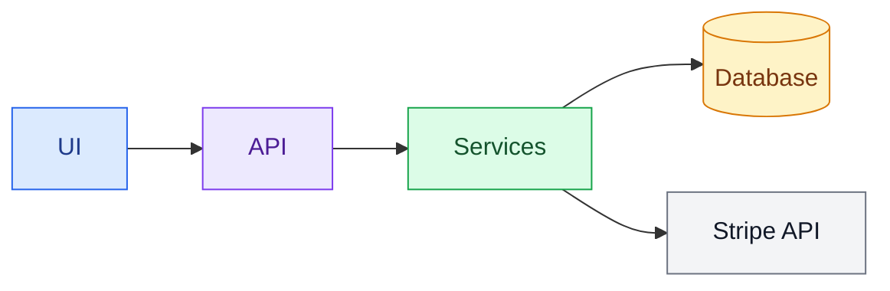
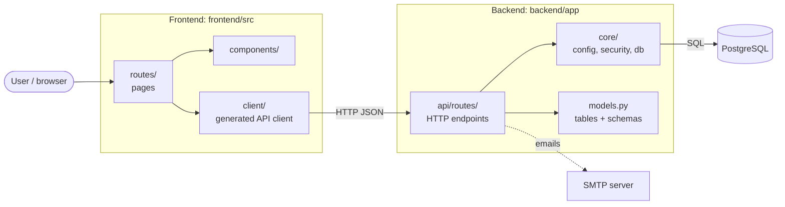
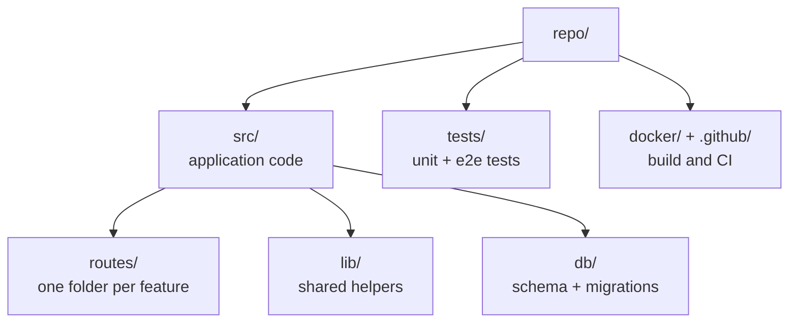
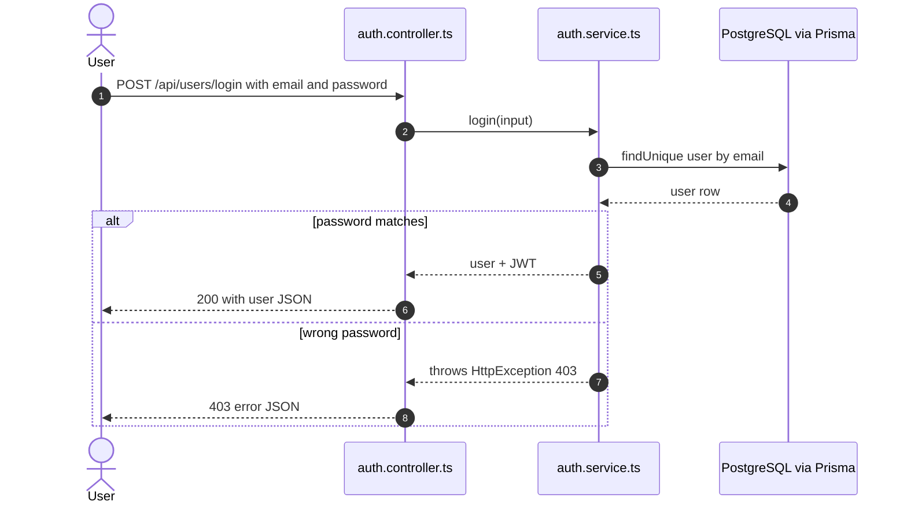
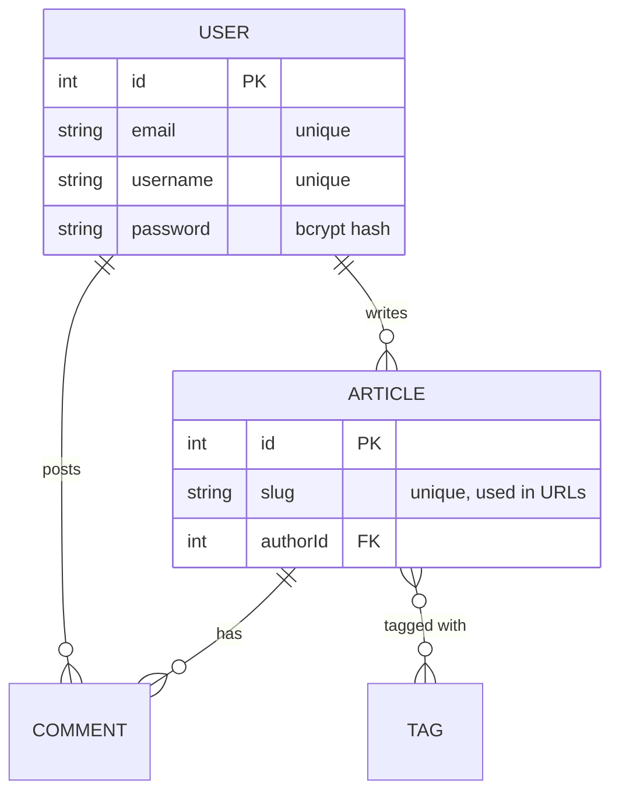
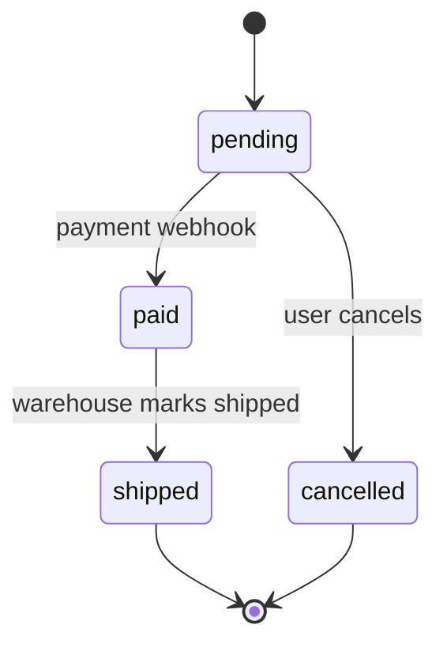
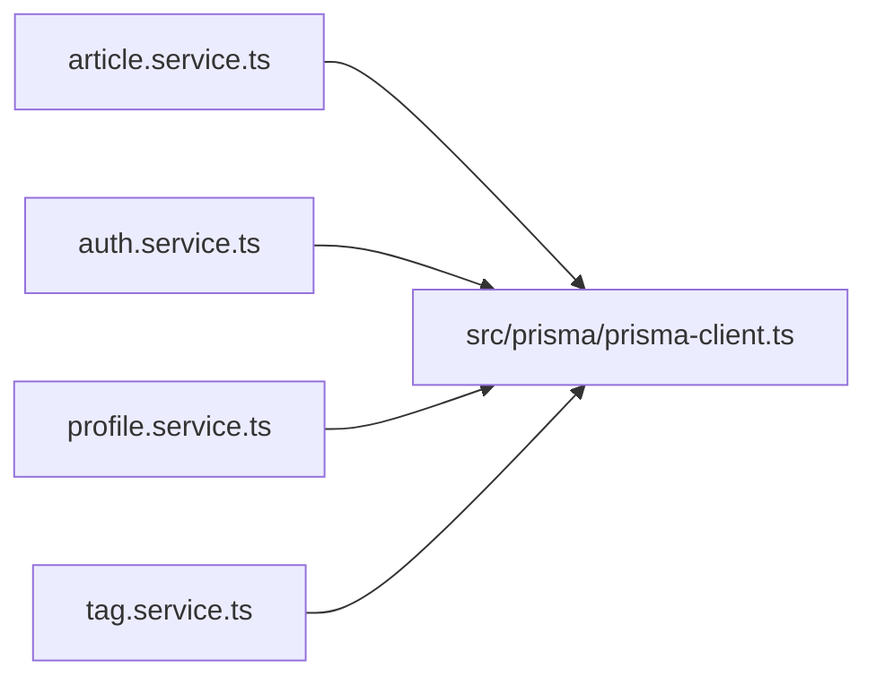
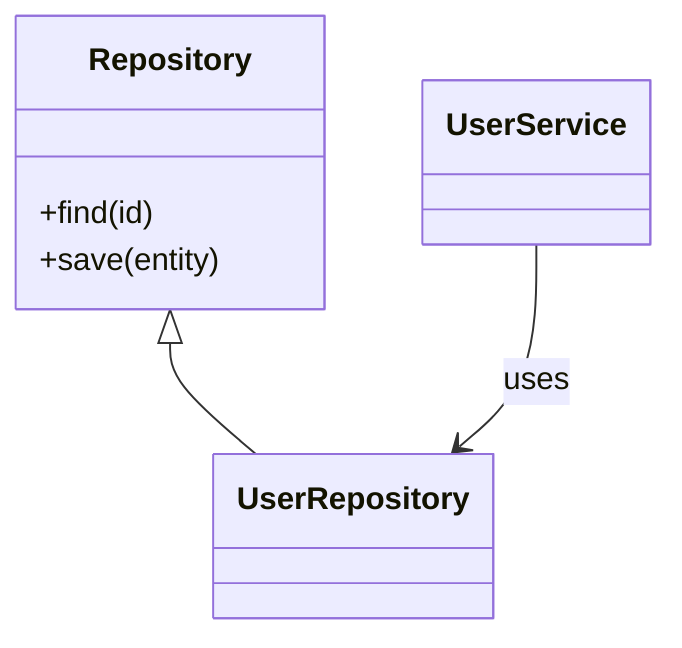

# Mermaid rules and patterns for codebase guides

GitHub, GitLab, VS Code and Obsidian render ```` ```mermaid ```` blocks as diagrams. One syntax slip shows the reader an error box instead, so follow these rules exactly.

## Syntax rules (these prevent almost every rendering failure)

1. **Quote every label:** `authSvc["auth.service.ts"]`. Inside quotes, slashes, dots, colons, parentheses and `&` are all safe. Without quotes, `(`, `)`, `[`, `]`, `{`, `}`, `;` and a leading `/` break the diagram.
2. **Node ids are plain words:** letters, digits and `_` only (`authSvc`, `db`, `routes_v1`). Never use `end`, `graph` or `subgraph` as an id. Do not start an id with `o` or `x` right after `--` (`A---oB` draws a circle edge).
3. **Quote edge labels:** `a -->|"calls (HTTP)"| b`.
4. **Subgraphs** get an id and a quoted title: `subgraph api ["Backend API (FastAPI)"]` … `end`. Every `subgraph` needs its own `end`.
5. **Sequence diagrams:** no `;` inside a message, because it ends the statement early. Close every `alt`, `opt`, `loop`, `par` and `rect` with `end`.
6. **ER diagrams:** entity names have no spaces (`USER`, `ORDER_ITEM`); relationships always have a label: `USER ||--o{ ORDER : places`.
7. **Line breaks** inside a quoted label: `<br/>`. No other HTML.
8. **No `%%{init}%%` theme blocks.** The host picks light or dark.
9. Keep each diagram **at or under ~15 nodes**. Two small diagrams beat one unreadable one. Use subgraphs for layers.
10. A literal double quote inside a label is written `#quot;`.

## Colour by role (optional, works in light and dark mode)



## 1. Architecture (section 4)

Build it from the scan: **architecture groups** become nodes and **folder-to-folder dependencies** become arrows. Merge small groups, then add what the scan cannot see: the user or browser, databases, queues and third-party APIs.



Shapes: `(["..."])` people, `[("...")]` databases and storage, `["..."]` code, dotted `-.->` for optional or async links.

## 2. Folder map (section 5)



A `mindmap` also works on GitHub, but the flowchart above is the most reliable everywhere.

## 3. Main flow (section 6)

Participants are files or layers, named so the reader can find them. Messages name the real function.



## 4. Data model (section 7)



Show only the important columns: ids, foreign keys, and fields the logic depends on.

## 5. Lifecycle or status (optional)

Use this when a status field drives behaviour (orders, jobs, payments).



## 6. Hub-file dependency view (optional)

Use this when a few files carry most of the app (highest "In" in the scan).



## 7. Class diagram (optional, for OOP-heavy code)


